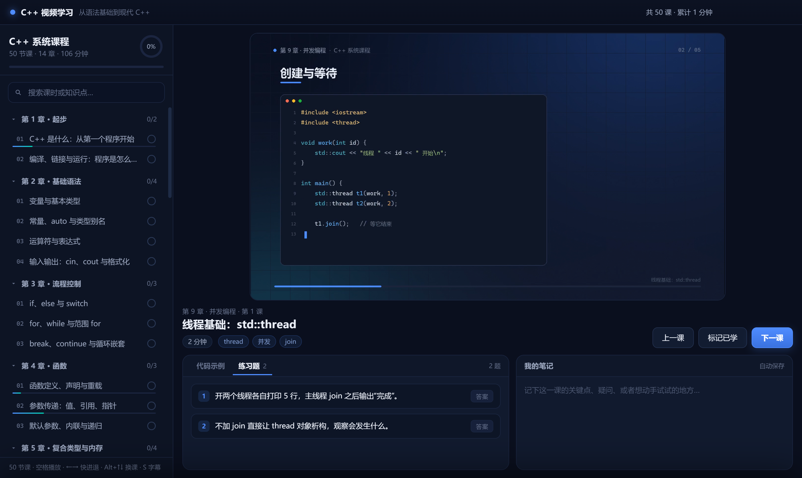
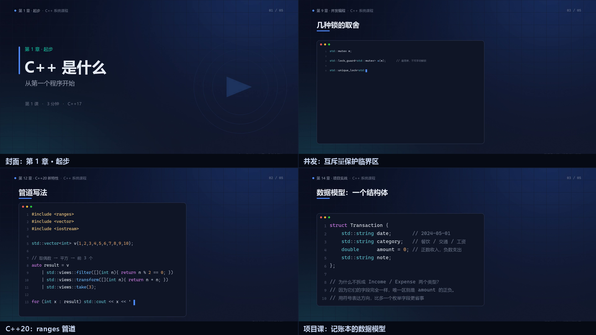
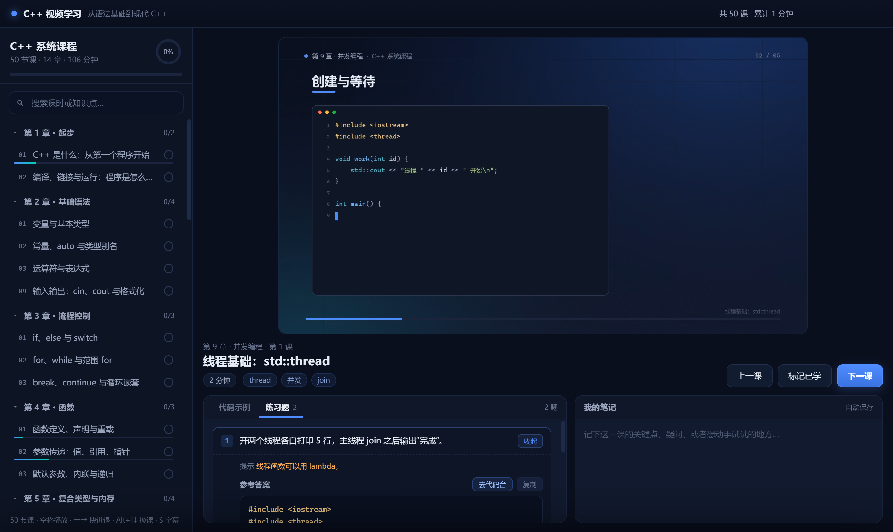
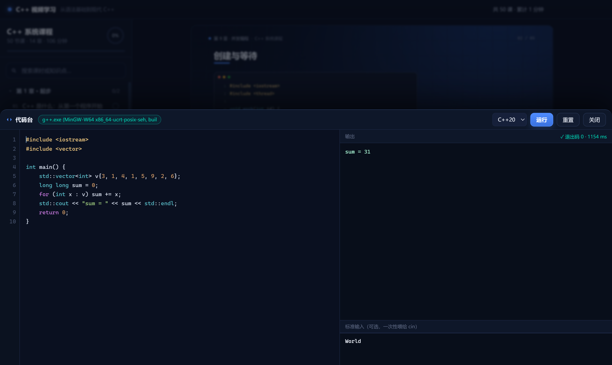

# C++ 视频学习 · CppVideoLearner

一个把「看视频 + 读代码 + 做练习 + 动手跑 + 记笔记 + 跟进度」放在一起的 C++ 学习软件。

**50 节课程视频全部由代码生成**（画面、动效、中文旁白、字幕），不是录屏，也不是素材拼贴；
**100 道练习题**的参考答案和**软件内置的代码台**都能直接编译运行。



课程视频本身也是代码画出来的：



---

## 快速开始

### 方式一：绿色版文件夹（最稳）

双击 `release/win-unpacked/CppVideoLearner.exe`，无需安装，不写注册表。

### 方式二：单文件 exe

双击 `release/CppVideoLearner.exe`（首次启动会自解压到临时目录，稍慢几秒）。

### 方式三：浏览器直接打开

双击 `src/renderer/index.html`（推荐 Chrome / Edge）。
课程数据与视频都在同一个目录树里，浏览器版用 localStorage 记录进度。
**注意：浏览器版没有「代码台」**，因为编译需要主进程调用本地 g++。

### 方式四：从源码启动

```bash
# 需要 Node.js 18+
pnpm install
# 若 Electron 二进制未下载，手动补一次：
#   node node_modules/electron/install.js
pnpm start
```
或者直接双击仓库根目录的 `启动应用.bat`。

> **受限环境提示**：如果双击后窗口一闪就没了（企业策略、远程桌面、虚拟桌面、
> 沙箱等环境可能出现），请用 `启动应用.bat` 启动，它带了 `--no-sandbox`
> 和独立数据目录参数，可绕过该问题。

---

## 代码台需要本地编译器

「写代码 → 立刻编译运行」这个功能依赖本机的 g++，软件会自己找，找不到时会提示。

```powershell
# 一条命令装好（GCC 16 + MinGW-w64，约 200 MB）
winget install BrechtSanders.WinLibs.POSIX.UCRT
```

装完重启本应用即可。也可以用 MSYS2、便携版 MinGW，或者设置环境变量
`CPP_COMPILER` 指向你的 `g++.exe`。

软件会在这些位置找 g++：环境变量 `CPP_COMPILER` → `PATH` → WinGet 包目录 →
`C:\msys64` / `C:\mingw64` / `C:\Program Files\mingw-w64` 等常见路径。

代码台的行为：

- 默认 `-std=c++20 -O0 -Wall -Wextra`，可切 C++17
- 编译超时 30 秒、运行超时 6 秒
- 编译错误原样展示 g++ 的报错，带文件名和行号
- 输出超过 2 万字符自动截断
- 编译产物在应用数据目录的临时工作区，跑完自动清理
- g++ 的临时目录会被指到工作区，避免受限环境下系统 TEMP 不可写而报错

---

## 里面有什么

| 模块 | 内容 |
| --- | --- |
| 课程 | 14 章 50 课，共约 2 小时视频 |
| 练习题 | 每课 2 道，共 100 道，含提示、参考答案、讲解 |
| 代码台 | 内置编辑器（语法高亮 + 行号），调用本地 g++ 编译运行 |
| 代码 | 每课附视频中讲解的代码片段，一键复制或丢进代码台 |
| 笔记 | 每课独立笔记，自动保存 |
| 进度 | 记录播放位置、续播、完成标记、章节进度环 |
| 项目课 | 第 14 章用一个 270 行的命令行记账本串起全部知识 |

练习题直接在软件里做，答案可以一键丢进代码台：



代码台调用本地 g++，写错立刻看到编译器报错：



### 课程大纲（14 章 50 课）

| 章节 | 内容 |
| --- | --- |
| 1 起步 | C++ 是什么；编译、链接与运行 |
| 2 基础语法 | 变量与类型；常量与 auto；运算符；输入输出 |
| 3 流程控制 | if/switch；for/while；break 与嵌套 |
| 4 函数 | 定义与重载；三种参数传递；默认参数与递归 |
| 5 复合类型与内存 | 数组与 std::array；std::string；指针；引用 |
| 6 面向对象 | 类与对象；构造析构与 RAII；封装与 const；继承 |
| 7 多态与现代 C++ | 虚函数；智能指针；STL 容器；算法/lambda/移动语义 |
| 8 实战 | 异常与文件 IO；综合项目 |
| 9 并发编程 | thread；mutex 与死锁；条件变量；atomic 与内存序；async/future |
| 10 工具链与调试 | 多文件工程；CMake；gdb；sanitizer；性能剖析 |
| 11 模板与泛型 | 函数模板；类模板；特化与 if constexpr |
| 12 C++20 新特性 | concepts；ranges；span/string_view；三路比较 |
| 13 工程实践 | 错误处理；RAII 进阶；接口设计与测试 |
| 14 项目实战 | 命令行记账本：设计 → 核心实现 → 持久化 → 收尾 |

---

## 界面操作

| 操作 | 说明 |
| --- | --- |
| 空格 | 播放 / 暂停 |
| ← / → | 后退 / 前进 5 秒 |
| Alt + ↑ / ↓ | 上一课 / 下一课 |
| S | 开关字幕 |
| N | 聚焦笔记 |
| Ctrl + Enter | 在代码台里运行代码 |
| Esc | 关闭代码台 |
| 搜索框 | 按标题、知识点或章节过滤 |

进度保存在：

- 桌面版：`%APPDATA%/CppVideoLearner/learn-state.json`
  （或程序目录下的 `userdata/learn-state.json`，取决于哪个可写）
- 浏览器版：`localStorage`

---

## 视频是怎么生成的

`tools/` 下是一条完整的「课程即代码」流水线，没有用到任何录屏或剪辑软件：

```
course_a/b/c/d.py          课程内容：每页的标题、要点、代码、旁白文字
        │
        ▼
engine.py                  渲染引擎（Pillow）
  ├─ 1920×1080 画布，numpy 渐变背景 + 抖动消除色带
  ├─ C++ 词法高亮（自写 tokenizer，中文用雅黑补位，避免等宽字体缺字形）
  ├─ 逐字打字动画、条目淡入、进度条
  └─ 五种版式：封面 / 要点 / 代码 / 终端 / 回顾
        │
        ▼
build_videos.py            时间轴与合成
  ├─ Windows TTS（Microsoft Huihui）逐页合成旁白 wav
  ├─ 页面时长 = 旁白时长 + 留白，对齐到帧
  ├─ 帧序列经管道直接写入 ffmpeg → H.264
  ├─ 旁白拼接静音对齐 → AAC 音轨 → 封装 mp4
  └─ 同时产出 VTT 字幕、缩略图、时间轴缓存
        │
        ▼
build_data.py              汇总成前端数据
  ├─ 合并 exercises.py + exercises_extra.py 的 100 道题
  └─ assets/data/course-data.js（含字幕与练习，规避 file:// 的 fetch 限制）
```

重新生成全部视频：

```bash
python tools/build_videos.py --jobs 4     # 约 25 分钟（4 进程）
python tools/build_data.py                # 刷新前端数据
python tools/make_icon.py                 # 重新生成图标
```

只做某几课：

```bash
python tools/build_videos.py --only l27,l47 --jobs 2
```

---

## 自测

仓库带了三个基于 Chrome DevTools Protocol 的自测脚本：

| 脚本 | 覆盖 |
| --- | --- |
| `tools/test-ui.js` | 课时/章节渲染、切换、视频源、代码高亮、练习折叠、笔记持久化、完成标记、搜索、快捷键 |
| `tools/test-playground.js` | 代码台：编译器探测、运行输出、编译报错、标准输入、高亮、行号、抽屉开关 |
| `tools/test-runner.js` | 直接测编译运行器：正常输出、stdin、编译错误、死循环超时、C++20 ranges |

```bash
# 应用需以调试端口启动：
#   CppVideoLearner.exe --no-sandbox --user-data-dir=... --remote-debugging-port=9225
set CDP_PORT=9225 && node tools/test-ui.js
node tools/test-playground.js
node tools/test-runner.js
```

---

## 打包

### Windows

```bash
pnpm run build:win      # release/CppVideoLearner-Setup-2.0.0.exe（NSIS 安装包）
pnpm run build          # 同 build:win
```

打包体积主要来自视频。`asar` 已关闭，保证 `file://` 能直接读取视频流。

### macOS

代码已经跨平台了——编译器探测（macOS 用 `clang++`）、进程终止、应用菜单、字体栈、
标题栏内边距都做了平台分支。但 **.dmg 必须在 macOS 上构建**，electron-builder 明确拒绝在
Windows 上打 mac 目标：

```
⨯ Build for macOS is supported only on macOS, please see https://electron.build/multi-platform-build
```

**有 Mac 的话，三条命令：**

```bash
xcode-select --install                  # Xcode 命令行工具，代码台的 clang++ 也来自这里
pnpm install && node node_modules/electron/install.js
pnpm run build:mac                      # 同时产出 arm64 与 x64 的 dmg
```

产物：`release/CppVideoLearner-2.0.0-arm64.dmg`、`release/CppVideoLearner-2.0.0-x64.dmg`

**没有 Mac 的话，用 GitHub Actions：**

仓库里已配好 `.github/workflows/build-mac.yml`。推到 GitHub 后：
Actions → **Build macOS** → Run workflow → 跑完在工作流页面底部下载 Artifacts。

注意仓库需要包含 `assets/videos/`（约 237 MB）——每个 mp4 都远小于 GitHub 的 100 MB 单文件上限，
可以直接提交；如果嫌仓库大，改用 Git LFS。

**首次打开会被 Gatekeeper 拦**

打包配置里 `identity: null`（不签名），所以 macOS 会提示「无法验证开发者」或「已损坏」：

1. 右键 App → 打开（一次即可）
2. 或终端执行 `xattr -cr /Applications/CppVideoLearner.app`
3. 想彻底免提示，需要 Apple Developer 证书（99 美元/年）签名并公证

**macOS 上的代码台**

用系统自带的 `clang++`（不是 g++）。软件会依次探测 `CPP_COMPILER` 环境变量、
`PATH` 里的 `clang++` / `g++` / `c++`、以及 `/usr/bin`、`/opt/homebrew/bin` 等固定位置。
没装命令行工具时，编译会提示 `xcode-select --install`。

---

## 目录结构

```
CppVideoLearner/
├─ src/
│  ├─ main/          Electron 主进程 + preload + 编译运行器(runner.js)
│  └─ renderer/      界面：index.html / style.css / app.js
├─ assets/
│  ├─ videos/        50 个 mp4
│  ├─ data/          course.json、course-data.js、VTT 字幕
│  ├─ thumbs/        课时缩略图
│  └─ samples/       account_book.cpp（项目课的完整源码）
├─ tools/            视频生成流水线 + 课程数据 + 练习题 + 自测脚本
├─ build/            图标等打包资源
└─ release/          打包产物
```

---

## 说明

- 视频是**代码生成的动画课**：幻灯片式讲解 + 代码打字 + 中文语音旁白，不是真人出镜。
- 语音由 Windows 内置 TTS（Microsoft Huihui）合成，音色取决于系统。
- 画面字体依赖 Windows 自带的微软雅黑与 Cascadia Mono。
- 50 节课是「完整地图 + 可动手练习」，不是「学完即精通」。真正的进步来自把代码台里的例子改坏再改好。
